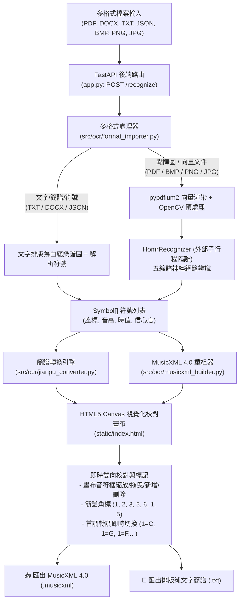

# ScoreOCR Toolkit 專案交接與後續維護手冊 (Project Handover Document)

本文件為 **ScoreOCR Toolkit** 專案的正式交接手冊，旨在完整記錄專案的 GitHub 資訊、核心架構、檔案結構、已完成功能、後續擴充方向，以及如何繼續透過 Git / GitHub 上傳與維護專案內容。

---

## 一、GitHub 帳號與專案資訊

| 項目 | 詳細資訊 |
| :--- | :--- |
| **GitHub 帳號 (Username)** | `Hankdress` / `Jimmy-hankdress` |
| **GitHub 綁定 Email** | `126248131+Jimmy-hankdress@users.noreply.github.com` |
| **專案儲存庫 (Repository URL)** | [https://github.com/Jimmy-hankdress/score-ocr-toolkit.git](https://github.com/Jimmy-hankdress/score-ocr-toolkit.git) |
| **專案主頁面** | [https://github.com/Jimmy-hankdress/score-ocr-toolkit](https://github.com/Jimmy-hankdress/score-ocr-toolkit) |
| **預設主分支 (Branch)** | `main` |
| **授權條款 (License)** | **MIT License**（主專案）/ **AGPL-3.0**（外部隔離選用之 HOMR 引擎） |
| **主要技術棧** | Python 3.11+、FastAPI、Uvicorn、OpenCV、Pillow、pypdfium2、python-docx、HTML5 Canvas、HOMR (PyTorch/ONNX) |

---

## 二、專案內容與核心架構概述

**ScoreOCR Toolkit** 是一個本機優先（Local-first）的樂譜光學辨識（OMR）與雙向校對系統，解決了傳統樂譜辨識「難以人工微調」與「格式封閉」的痛點。

### 核心功能矩陣



1. **多格式輸入相容（Multi-Format Input）**：
   - 支援 PDF 向量樂譜（以 Google PDFium 高解析度光柵化，免裝 Poppler）。
   - 支援 Word 文檔（`.docx`，優先提取高清插圖，或將內文簡譜文字渲染成白底樂譜）。
   - 支援純文字文字譜（`.txt`，支援如 `1 2 3 1 | 3 4 5 -` 簡譜或 ABC 音名）。
   - 支援 JSON 符號列表（`.json`，供第三方系統對接）。
   - 支援所有主流點陣圖（`.bmp`、`.webp`、`.tiff`、`.png`、`.jpg`）。
2. **開源授權隔離架構**：
   - 利用 `subprocess` 外部行程執行 HOMR CLI，維護核心專案的純粹 MIT 授權，避免 AGPL 條款感染整個專案。
3. **簡譜（Numbered Musical Notation）雙向轉換**：
   - 支援首調記譜法（Movable Do），可任意指定調號（`1=C`, `1=D`, `1=G`, `1=F`, `1=Bb` 等）。
   - 標準 Unicode 結合點標註八度（高八度 $1̇$、低八度 $5̣$）。
   - 依拍號（`4/4`, `3/4`, `2/4`, `6/8`）自動累計拍數並排版小節線與延音/減時線。
4. **HTML5 Canvas 視覺化校對畫布**：
   - 支援滑鼠縮放（Zoom）、平移（Pan）、框線拖曳位移與四角大小微調。
   - 畫布上每個音符同時顯示五線譜音名與綠色**簡譜角標**。
   - 內建虛擬鋼琴鍵盤（CDEFGAB）、升降記號、時值切換（全音符至 32 分音符）。
   - 雙格式一鍵下載：可匯入 MuseScore 的標準 MusicXML 與純文字簡譜檔。

---

## 三、專案目錄結構與所有檔案存放位置

本專案本機根目錄為：`d:\goodle cloud\score-ocr-toolkit`

```text
d:\goodle cloud\score-ocr-toolkit
│
├── .gitignore                      # Git 版本控制忽略設定檔 (排除 .venv, 暫存圖檔)
├── app.py                          # FastAPI 主服務程式 (提供所有 API 端點與靜態資源)
├── LICENSE                         # MIT 開源授權條款
├── README.md                       # 專案中文說明與 Swagger API 導覽
├── requirements.txt                # 主專案核心 Python 套件依賴
├── requirements-homr.txt           # 選用 HOMR 模組依賴 (AGPL 隔離)
├── PROJECT_HANDOVER.md             # 本份交接手冊
│
├── src/                            # 後端核心演算法與業務邏輯模組
│   └── ocr/
│       ├── __init__.py             # 模組初始化檔
│       ├── recognizer.py           # 核心資料類別 Symbol 與 BaseRecognizer 抽象介面
│       ├── homr_recognizer.py      # HOMR 外部 CLI 子行程調用器 (授權隔離層)
│       ├── format_importer.py      # 多格式文件/圖片轉換器 (PDF, DOCX, TXT, JSON, BMP)
│       ├── jianpu_converter.py     # 簡譜轉調、八度點、拍號小節線排版引擎
│       ├── note_extractor.py       # OpenCV 影像形態學音符頭輪廓定位與配對器
│       └── musicxml_builder.py     # 將校對後符號列表重新組裝為標準 MusicXML 4.0
│
├── static/                         # 前端使用者介面與靜態檔案
│   ├── index.html                  # 視覺化 Canvas 互動校對與簡譜操作前端單頁應用 (SPA)
│   └── favicon.ico                 # 網站高解析度現代音符圖示 (避免 F12 404 錯誤)
│
├── uploads/                        # 使用者上傳暫存目錄
├── processed/                      # 系統執行過程產生的中繼圖、MusicXML 與簡譜純文字產出
│
└── .venv/                          # Python 3.11 虛擬環境 (依賴套件安裝於此，不納入 Git)
```

### 關鍵檔案功能索引

| 相對路徑 | 功能說明 | 維護重點 |
| :--- | :--- | :--- |
| `app.py` | 定義 `/recognize`, `/api/convert-to-jianpu`, `/download/{filename}` 等路由 | 新增 API 路由或修改檔案上傳大小限制時修改此處 |
| `src/ocr/format_importer.py` | 解析 PDF（pypdfium2）、Word（docx）、TXT、JSON | 若要擴充支援的新格式（如 MIDI 匯入或 MusicXML 匯入）在此擴充 |
| `src/ocr/jianpu_converter.py` | 負責五線譜與簡譜轉換、調號換算、拍子小節分段 | 若要調整簡譜符號呈現（如三連音、切分音符號）在此調整 |
| `src/ocr/musicxml_builder.py` | 逆向組裝 W3C MusicXML 4.0 DOM 樹 | 若要匯出更多樂理記號（如連音線、表情記號）在此修改 |
| `src/ocr/homr_recognizer.py` | 以 `subprocess` 執行外部 `homr` 指令 | 調整 HOMR 執行參數或換用其他 OMR 引擎時修改 |
| `static/index.html` | 整合 Canvas 繪製、滑鼠互動、快捷鍵、側邊欄面板 | 前端 UI 佈局、配色、快捷鍵邏輯維護在此 |

---

## 四、目前專案進度與里程碑

截至目前，已在 GitHub 遠端儲存庫完成並推送 **17 個重要 Commits**：

| 階段 / 版本 | 提交代碼 (Commit) | 完成里程碑 |
| :--- | :--- | :--- |
| **階段一：基礎建設** | `7d110b0`, `d0ede5e`, `420af66` | 完成 FastAPI 架構、OpenCV 影像預處理、二值化與基礎路由 |
| **階段二：OMR 介面** | `ba842fc`, `6238b0c`, `c819c57` | 設計 `Symbol` 抽象資料模型與可插拔 `BaseRecognizer` |
| **階段三：HOMR 整合** | `0ab4230` ~ `9be7ba5` | 實作 subprocess 授權隔離調用、相容 Windows Python 3.11/3.12 |
| **階段四：畫布與校對** | `8b4a680`, `276e1db`, `406f8c1` | 實作音符輪廓提取、Canvas 互動畫布、音高鋼琴鍵與 MusicXML 匯出 |
| **階段五：容錯與除錯** | `4bfaf27` | 解決 F12 404/422 錯誤：新增 Favicon、自動引導對話框、中文檔名安全機制 |
| **階段六：全格式與簡譜** | `b604046` | **支援 PDF、Word、TXT、JSON、BMP 上傳**，新增**簡譜雙向轉換、調號轉調、畫布簡譜角標與純文字簡譜下載** |
| **階段七：交接手冊維護** | 最新 Commit | 建立完整專案交接報告、更新目錄樹與後續維護 SOP |

---

## 五、後續維護與功能擴充建議 (Roadmap)

後續接手維護或繼續開發時，可依循下列建議方向進行擴充：

### 1. 批次處理與多頁樂譜支援 (Batch & Multi-page PDF)
- **現狀**：目前上傳 PDF 預設光柵化第 1 頁進行辨識。
- **後續擴充**：
  - 在前端加入頁碼導覽列（`上一頁` / `下一頁`）。
  - 將 PDF 的所有頁面分別渲染，並將各頁符號匯總輸出為單一多小節的 MusicXML 與簡譜文字檔。

### 2. 音訊合成與即時試聽功能 (Audio Playback)
- **後續擴充**：
  - 在前端引入 `Tone.js` 或利用後端 `pretty_midi` / `mido` 將 `Symbol[]` 轉換為標準 MIDI。
  - 在畫布工具列加入「▶ 播放 / 暫停」按鈕，撥放時讓畫布游標高亮跟隨音符前進，方便即時校對聽辨錯音。

### 3. 歌詞辨識與對齊 (Lyrics OCR & Alignment)
- **後續擴充**：
  - 接入輕量 OCR（如 `RapidOCR` 或 `PaddleOCR`）。
  - 偵測五線譜或簡譜下方的文字行，將漢字歌詞依據水平 X 座標自動綁定至對應的音符屬性中。

### 4. 簡譜排版圖形化輸出 (Jianpu SVG / PDF Rendering)
- **後續擴充**：
  - 目前簡譜提供工整的純文字格式（`.txt`）。
  - 可進一步加入基於 SVG 或 HTML Canvas 的排版匯出，支援列印等級的高清 PDF 簡譜下載。

---

## 六、如何繼續上傳至 GitHub 補充專案內容 (維護 SOP)

為了確保專案能穩定持續更新至 GitHub，請遵循以下操作步驟：

### 步驟 1：啟動本機虛擬環境並確認狀態

在專案目錄開啟 PowerShell 或 Terminal：

```powershell
cd "d:\goodle cloud\score-ocr-toolkit"

# 啟動 Python 虛擬環境
.\.venv\Scripts\activate

# 檢查當前 Git 狀態與是否有修改未提交
git status
```

### 步驟 2：本機測試驗證

在修改任何程式碼（例如 `app.py` 或 `src/ocr/` 模組）後，請先啟動伺服器確認運作正常：

```powershell
# 啟動本機測試伺服器
uvicorn app:app --reload --host 127.0.0.1 --port 8000
```
開啟瀏覽器測試 `http://127.0.0.1:8000/`，確認無報錯後再進行提交。

### 步驟 3：暫存變更檔案 (git add)

```powershell
# 查看異動清單
git status

# 加入特定修改的檔案
git add app.py src/ static/ README.md PROJECT_HANDOVER.md

# 或一次加入所有非忽略的異動
git add .
```

### 步驟 4：建立版本提交 (git commit)

提交訊息請維持專案風格，以動詞開頭清楚描述本次變更內容：

```powershell
# 範例一：新增功能
git commit -m "Add multi-page PDF batch processing support"

# 範例二：修復問題
git commit -m "Fix jianpu octave dot rendering on high notes"

# 範例三：更新文件
git commit -m "Update project handover documentation and roadmap"
```

### 步驟 5：推送到 GitHub 遠端儲存庫 (git push)

```powershell
# 推送至 origin 的 main 分支
git push origin main
```

> [!TIP]
> **GitHub 憑證說明**：
> 本機已配置 GitHub Credential Helper，推送時會自動使用已驗證之帳號憑證。
> 若未來在其他電腦或環境遇到授權提示：
> 1. 請前往 GitHub 網站：`Settings` → `Developer settings` → `Personal access tokens` (Tokens classic)。
> 2. 生成一組具備 `repo` 權限的 Token。
> 3. 在終端機提示輸入 Password 時貼上該 Personal Access Token 即可。

### 步驟 6：分支管理最佳實踐 (建議)

當要開發重大新模組（例如 MIDI 撥放器）時，建議建立功能分支：

```powershell
# 1. 建立並切換至新功能分支
git checkout -b feature/midi-playback

# 2. 開發並提交
git add .
git commit -m "Add MIDI playback module using Tone.js"

# 3. 推送新分支到遠端
git push -u origin feature/midi-playback

# 4. 測試無誤後，合併回 main 分支
git checkout main
git merge feature/midi-playback
git push origin main
```

---

## 七、交接總結

- **現狀成果**：本專案已完全實現五線譜/簡譜/多格式（PDF/Word/TXT/JSON/BMP）全方位辨識、互動式網頁 Canvas 視覺化校對，以及 MusicXML 4.0 / 簡譜純文字雙格式匯出，具備完整的商業級 MVP 架構。
- **儲存庫同步**：所有原始碼、前端介面與測試驗證腳本均已安全儲存於本機 `d:\goodle cloud\score-ocr-toolkit` 並同步至 GitHub `main` 分支。
- **接手重點**：依照上述維護 SOP 即可無縫接續進行後續功能迭代與版次發布。
