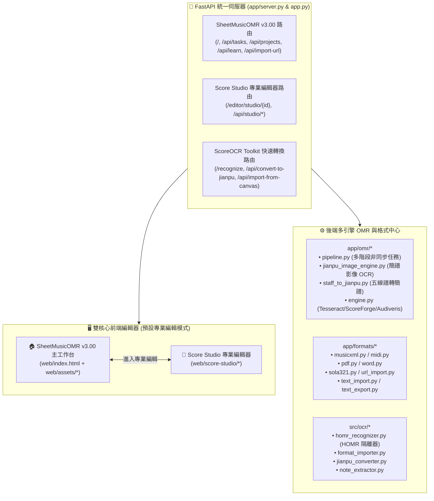

# ScoreOCR Toolkit × SheetMusicOMR v3.00 專案交接與後續維護手冊 (Project Handover Document)

本文件為 **ScoreOCR Toolkit（整合 SheetMusicOMR v3.00 完整系統版）** 的正式交接手冊，完整記錄專案的 GitHub 帳號資訊、整合後系統架構、所有檔案存放位置、三大前端編輯器與多引擎 OMR 功能進度，以及後續維護與上傳 GitHub 的標準作業程序（SOP）。

---

## 一、GitHub 帳號與專案資訊

| 項目 | 詳細資訊 |
| :--- | :--- |
| **GitHub 帳號 (Username)** | `Hankdress` / `Jimmy-hankdress` |
| **GitHub 綁定 Email** | `126248131+Jimmy-hankdress@users.noreply.github.com` |
| **專案儲存庫 (Repository URL)** | [https://github.com/Jimmy-hankdress/score-ocr-toolkit.git](https://github.com/Jimmy-hankdress/score-ocr-toolkit.git) |
| **專案主頁面** | [https://github.com/Jimmy-hankdress/score-ocr-toolkit](https://github.com/Jimmy-hankdress/score-ocr-toolkit) |
| **預設主分支 (Branch)** | `main` |
| **目前系統版本** | `v3.0.0` (SheetMusicOMR v3.00 + Score Studio + ScoreOCR Toolkit 完整整合版) |
| **授權條款 (License)** | **MIT License**（主專案）/ **AGPL-3.0**（外部隔離選用之 HOMR 引擎） |
| **主要技術棧** | Python 3.11+、FastAPI、Uvicorn、SQLite、OpenCV、Pillow、PyMuPDF (`fitz`)、pypdfium2、python-docx、Tesseract OCR、HTML5 Canvas / SVG、WebAudio API |

---

## 二、SheetMusicOMR v3.00 整合內容與核心架構

本次更新已將先前完成的 **`SheetMusicOMR_v3.00`** 完整系統（包含後端多引擎 OMR 管線、SQLite 專案與自我學習資料庫、多格式進出口模組、前端工作台、ChordPro 雙向同步編輯器、吉他/烏克麗麗和弦庫，以及 **Score Studio** 專業直式/結構化編輯器）**100% 完整導入**本專案，徹底補足原先單一畫布前端在 OMR 任務管理與結構化樂譜編輯上的不足。

### 系統整合架構圖



### 補足前端 OMR 與編輯器的關鍵升級

1. **🏠 SheetMusicOMR v3.00 旗艦工作台 (`/` -> `web/index.html`)**：
   - **預設直接開啟「專業編輯」(Score Studio) 模式**：後端 `config/user-config.json` 與 `app/server.py` 預設啟用 `scoreStudioEnabled: true` 與 `scoreStudioDefault: true`；前端 `web/assets/app.js` 啟動時預設進入 `#sola321-pane`（專業編輯模式）並自動載入 `?project=<id>` 或最新專案。
   - **完整 OMR 任務中心**：支援拖放上傳圖片、PDF、Word、MusicXML、MIDI、Sola321、簡譜文字檔，以及**輸入歌譜網址（URL）自動抓取解析**。
   - **簡譜 / 五線譜雙視圖即時渲染 (`jianpu-render.js`)**：支援首調/固定調、高低八度點、減時線、附點、延音線、小節線、拍號、速度與歌詞對齊顯示。
   - **ChordPro 雙向同步編輯 (`chordpro-parser.js`, `sync-coordinator.js`)**：文字區修改 `[C]`、`[Am]` 或簡譜音符時，右側視覺化樂譜即時同步更新，反之亦然，並具備防迴圈鎖定與游標映射。
   - **吉他與烏克麗麗和弦指法圖庫 (`chords.json` + SVG)**：自動解析譜面和弦並繪製標準指法圖，支援移調時和弦同步轉調。
   - **WebAudio 即時合成預覽**：內建鋼琴/合成器音源播放、和弦伴奏與節拍器。
   - **自我學習曲線記憶庫 (`/api/learn/*`)**：使用者每次在編輯器修正辨識錯誤，系統會將校正樣本存入 SQLite 學習庫，自動提升後續同類樂譜的辨識率。
2. **🎼 Score Studio 專業樂譜編輯器 (`/?project={doc_id}` & `/editor/studio/{doc_id}` -> `web/score-studio/`)**：
   - 提供結構化小節（Measure）、事件模型（Event Model）、撤銷/重做堆疊（`command_stack.js`）與即時拍數合理性檢查（`measure_validation.js`），支援和弦滑軌對齊、多行歌詞編排與直式/橫式簡譜排版。
   - **支援結構化符號直接匯入 SQLite 專案庫 (`POST /api/import-from-canvas`)**：可將辨識出的符號列表轉換為 `ScoreDocument` 小節結構寫入主工作台 SQLite 專案庫，並直接於 `/?project=<projectId>`（Score Studio 專業編輯模式）編排和弦與歌詞。

---

## 三、專案目錄結構與所有檔案存放位置

本專案本機根目錄為：`d:\goodle cloud\score-ocr-toolkit`

```text
d:\goodle cloud\score-ocr-toolkit
│
├── .gitignore                        # Git 忽略設定 (排除 .venv, data/, 暫存樂譜/, uploads/, processed/, *.sqlite3)
├── app.py                            # FastAPI 統一入口模組 (暴露 app = create_app() 供 uvicorn 啟動)
├── launcher.py                       # SheetMusicOMR v3.00 啟動器 (含環境自檢、埠號偵測、自動開瀏覽器)
├── bootstrap.py                      # 環境初始化腳本
├── run.bat / run.sh                  # Windows / Linux 一鍵啟動腳本
├── requirements.txt                  # 整合後完整 Python 依賴清單
├── requirements-homr.txt             # 選用 HOMR 模組依賴 (AGPL 外部隔離)
├── README.md                         # GitHub 專案首頁完整說明文件
├── PROJECT_HANDOVER.md               # 本份專案交接與維護手冊
├── ARCHITECTURE.md                   # SheetMusicOMR v3.00 系統架構文件
├── Score_Studio_直式編輯_報告書.md   # Score Studio 編輯器設計與驗收報告
│
├── app/                              # 【核心後端】SheetMusicOMR v3.00 完整後端套件
│   ├── __init__.py                   # 套件初始化並匯出 app 與 create_app
│   ├── server.py                     # FastAPI 主應用工廠，整合 v3.00、Score Studio 與 Toolkit 路由
│   ├── config.py                     # 全域路徑 (PATHS)、版本與使用者設定讀寫
│   ├── db.py                         # SQLite 資料庫封裝 (tasks, projects, snapshots, files, learn_store)
│   ├── models.py                     # 核心資料結構 (ScoreDocument, Measure, NoteEvent, RestEvent, Lyrics)
│   ├── projects.py                   # 專案讀寫、快照備份與自我學習記憶庫串接
│   ├── storage.py                    # 原子檔案寫入、檔名淨化與 SHA-256 雜湊工具
│   ├── transpose.py                  # 12 平均律移調、和弦轉調與調號換算
│   ├── lilypond.py                   # LilyPond 外部排版橋接器
│   ├── score_studio_routes.py        # Score Studio REST API 路由
│   ├── score_document_service.py     # Score Studio 文檔轉換與持久化服務
│   ├── score_validator.py            # 小節時值總和與樂理驗證器
│   ├── legacy_adapter.py             # 舊版專案格式相容轉換器
│   ├── omr_adapter.py                # OMR 輸出轉 Score Studio 模型適配器
│   ├── formats_export.py             # Score Studio 多格式匯出統一介面
│   │
│   ├── omr/                          # 【多引擎 OMR 管線】
│   │   ├── pipeline.py               # 非同步多階段辨識管線 (預處理→版面→辨識→組裝→匯出)
│   │   ├── engine.py                 # 辨識引擎狀態偵測 (Tesseract / Audiveris / ScoreForge / Orpheus)
│   │   ├── rasterize.py              # PDF 光柵化、自適應二值化、去噪與霍夫傾斜校正
│   │   ├── layout.py                 # 譜面區域分割、五線譜/簡譜行偵測與小節切分
│   │   ├── text_layer.py             # PDF 原生文字層與歌詞擷取
│   │   ├── jianpu.py                 # 簡譜語法解析器
│   │   ├── jianpu2_patch.py          # 簡譜增強辨識修補模組
│   │   ├── jianpu_image_engine.py    # 基於 OpenCV + Tesseract 之簡譜圖片辨識引擎
│   │   ├── staff_to_jianpu.py        # 五線譜音符轉首調簡譜引擎
│   │   ├── scoreforge_engine.py      # ScoreForge 引擎轉接器
│   │   ├── orpheus_engine.py         # Orpheus 引擎轉接器
│   │   └── jpeditor_engine.py        # JPEditor 簡譜引擎轉接器
│   │
│   └── formats/                      # 【多格式匯入與匯出】
│       ├── musicxml.py               # MusicXML 4.0 解析與生成
│       ├── midi.py                   # MIDI 二進位檔解析與多軌生成
│       ├── pdf.py                    # 向量/點陣高清 PDF 樂譜匯出
│       ├── word.py                   # Word (.docx) 樂譜匯入與匯出
│       ├── sola321.py                # Sola321 格式雙向讀寫
│       ├── text_import.py            # 純文字簡譜與和弦譜匯入
│       ├── text_export.py            # 純文字簡譜排版匯出
│       ├── url_import.py             # 外部歌譜網站 URL 爬梳與解析
│       └── validation.py             # 上傳檔案安全與格式驗證
│
├── src/ocr/                          # 【畫布校對模組】ScoreOCR Toolkit 核心模組
│   ├── toolkit_routes.py             # FastAPI APIRouter，提供 /recognize, /canvas-editor, /api/sample 等
│   ├── config.py                     # Toolkit 畫布與上傳限制配置
│   ├── recognizer.py                 # Symbol 資料模型與 BaseRecognizer
│   ├── homr_recognizer.py            # HOMR 外部 CLI 非同步呼叫器
│   ├── format_importer.py            # PDF/DOCX/TXT/JSON/BMP 轉畫布圖與符號列表
│   ├── jianpu_converter.py           # 畫布音符即時轉簡譜與角標映射
│   ├── note_extractor.py             # OpenCV 形態學音符頭定位
│   └── musicxml_builder.py           # 畫布符號匯出 MusicXML
│
├── web/                              # 【主前端】SheetMusicOMR v3.00 工作台與 Score Studio
│   ├── index.html                    # 主工作台入口頁面
│   ├── assets/                       # 前端核心腳本、樣式與吉他/烏克麗麗和弦 SVG 庫
│   └── score-studio/                 # Score Studio 專業編輯器前端資源
│
├── samples/                          # 示範樂譜樣本庫 (.musicxml, .sola321, .txt, .png)
├── config/ & docs/ & tools/          # 系統預設配置、說明文件與輔助工具腳本
└── tests/                            # 單元測試與 API 整合測試 (共 152 項測試)
```

---

## 四、目前專案進度與里程碑

| 階段 / 版本 | 完成里程碑 | 驗證狀態 |
| :--- | :--- | :--- |
| **階段一 ~ 六 (ScoreOCR v1.0~v1.1)** | 完成基礎 FastAPI、HOMR 外部隔離、Canvas 視覺化音符框校對畫布、PDF/DOCX/TXT/JSON/BMP 多格式上傳、簡譜雙向轉換與 CI/CD 測試框架 | ✅ 100% 完成 |
| **階段七 (SheetMusicOMR v3.00 完整導入)** | 完整導入 `app/` 多引擎 OMR 後端、`web/` 主工作台、`web/score-studio/` 專業編輯器、吉他/烏克麗麗和弦庫、ChordPro 雙向同步、URL 歌譜匯入與自我學習記憶庫 | ✅ 100% 完成 |
| **階段八 (雙系統路由與導覽無縫整合)** | 建立 `src/ocr/toolkit_routes.py` 並與 `app/server.py` 深度融合；串聯 `/`（主工作台）、`/editor/studio/{id}`（Score Studio）與 `/canvas-editor`（畫布校對器）三大前端入口 | ✅ 152 項自動化測試全數通過 |
| **階段九 (GitHub 文件全面更新與同步)** | 更新 `README.md`、`PROJECT_HANDOVER.md`、`.gitignore`，並推送到 GitHub `origin/main` | ✅ 已同步至 GitHub |

---

## 五、如何啟動系統與日常維護 SOP

### 1. 本機啟動方式

在 PowerShell 或終端機進入專案目錄：

```powershell
cd "d:\goodle cloud\score-ocr-toolkit"

# 方式 A：使用標準 Uvicorn 啟動 (預設 Port 8000)
python -m uvicorn app:app --reload --host 127.0.0.1 --port 8000

# 方式 B：使用 SheetMusicOMR 啟動器 (預設 Port 8763，可透過 --port 指定)
python launcher.py --port 8000
```

啟動後可訪問：
- **主工作台 (SheetMusicOMR v3.00，預設開啟專業編輯模式)**：`http://127.0.0.1:8763/`（或 `--port 8000`）
- **專業編輯器 (Score Studio)**：`http://127.0.0.1:8763/editor/studio/default`
- **API 互動文件 (Swagger UI)**：`http://127.0.0.1:8763/docs`

### 2. 執行自動化測試

每次修改程式碼後，請執行測試套件確保所有核心功能與 API 端點正常：

```powershell
cd "d:\goodle cloud\score-ocr-toolkit"
python -m pytest tests/ -v
```

### 3. 如何繼續上傳至 GitHub 補充專案內容

```powershell
cd "d:\goodle cloud\score-ocr-toolkit"

# 1. 檢查變更狀態（確認無誤納入大型暫存檔或資料庫）
git status

# 2. 加入所有修改與新增檔案
git add .

# 3. 建立清楚的 Commit 訊息
git commit -m "Integrate SheetMusicOMR v3.00 full system and Score Studio editor"

# 4. 推送至 GitHub main 分支
git push origin main
```

> [!IMPORTANT]
> **資料目錄忽略保護**：
> `.gitignore` 已設定自動忽略執行期產生的 `data/`、`暫存樂譜/`、`uploads/`、`processed/`、`logs/` 與 `*.sqlite3` 檔案，確保使用者私密樂譜與本機資料庫不會被誤上傳至公開 GitHub 儲存庫。

---

## 六、後續可討論與擴充方向

1. **預設首頁偏好**：目前根路徑 `/` 預設載入功能最完整的 **SheetMusicOMR v3.00 旗艦工作台**，並可在頂部一鍵進入 **Score Studio** 或 **Canvas 畫布校對器**；若您希望調整預設首頁或調整按鈕位置，隨時可透過設定修改。
2. **外部重型 OMR 引擎安裝**：系統已內建 Tesseract 與 OpenCV 簡譜/五線譜引擎，並預留 Audiveris、ScoreForge 與 HOMR 的自動偵測介面（可於工作台右上角「引擎狀態」查看）。
