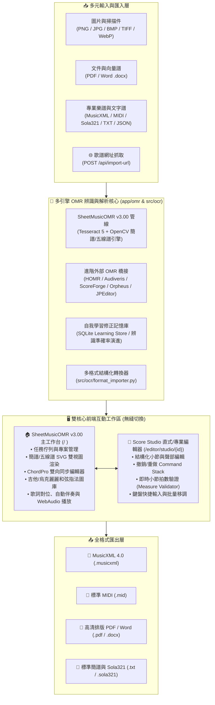

# ScoreOCR Toolkit × SheetMusicOMR v3.00 旗艦整合版

[](https://github.com/Jimmy-hankdress/score-ocr-toolkit/actions/workflows/ci.yml)
[](https://opensource.org/licenses/MIT)
[](https://www.python.org/downloads/)
[](https://github.com/Jimmy-hankdress/score-ocr-toolkit)
[](https://www.docker.com/)

**ScoreOCR Toolkit (v3.00 整合版)** 是結合 **SheetMusicOMR v3.00 離線多引擎樂譜辨識工作台** 與 **Score Studio 專業樂譜編輯器** 的完整本機優先（Local-first）樂譜數位化與編輯系統。

支援將各類樂譜影像、PDF、Word (`.docx`)、MusicXML、MIDI、Sola321 (`.sola321`)、簡譜文字 (`.txt` / `.jianpu` / `.jpu`)、JSON 以及歌譜網址（URL 匯入），透過多引擎 OMR 管線轉換並於前端進行視覺化互動編輯、吉他/烏克麗麗和弦指法配對、ChordPro 雙向同步、首調移調與多格式匯出。

---

## 🌟 系統核心架構 (System Architecture)



---

## ✨ 完整功能亮點

### 1. 補足前端 OMR 與雙核心專業編輯器生態
- **🏠 SheetMusicOMR v3.00 主工作台 (`/`)**：
  - **預設直接開啟「專業編輯」(Score Studio) 模式**：啟動或進入工作台時，預設直接切入 `Score Studio`（`#sola321-pane`）結構化專業編輯器，並自動載入指定專案或最新專案（若無專案則自動建立空白樂譜專案）。
  - **多階段 OMR 任務管線**：即時顯示上傳、預處理、版面分析、音符/文字辨識與封裝進度。
  - **簡譜與五線譜雙模式渲染**：內建 `jianpu-render.js` 與 SVG 樂譜排版引擎，支援高/低八度點、減時線、延音線、附點、小節線與拍號顯示。
  - **ChordPro 雙向即時同步 (`chordpro-parser.js` / `sync-coordinator.js`)**：支援 `[C]一閃一閃[G]亮晶晶` 語法與視覺化小節雙向同步編輯。
  - **吉他 / 烏克麗麗和弦指法圖庫 (`web/assets/chords.json` & SVG)**：內建常用和弦指型 SVG 與自動和弦推算。
  - **WebAudio 合成播放與伴奏**：支援單音、和弦伴奏、節拍器與速度（BPM）動態調整。
  - **自我學習曲線記憶庫 (`/api/learn/*`)**：自動記錄人工校對結果，持續優化後續 OMR 辨識準確率。
- **🎼 Score Studio 專業編輯器 (`/?project={doc_id}` / `/editor/studio/{doc_id}`)**：
  - 採用事件驅動模型（Event Model）與命令堆疊（Command Stack），提供完整的 Undo / Redo、小節拍數合理性檢查（Measure Validation）、和弦滑軌對位、多行歌詞編排與直式/橫式簡譜排版。

### 2. 多引擎 OMR 與多格式匯入/匯出
- **支援匯入格式**：
  - 影像：`.png`, `.jpg`, `.jpeg`, `.bmp`, `.tif`, `.tiff`, `.webp`
  - 文件與樂譜：`.pdf`（自動判斷向量文字層或高解析度光柵化）、`.docx`（Word 樂譜提取）、`.musicxml`, `.xml`, `.mid`, `.midi`, `.sola321`, `.txt`, `.jianpu`, `.jpu`, `.json`
  - 網址匯入：支援輸入歌譜網址自動擷取解析（`POST /api/import-url`）
- **支援 OMR 引擎**：
  - 內建 OpenCV + Tesseract 5 簡譜與歌詞離線辨識引擎
  - 支援外接 **HOMR**（subprocess 授權隔離，維持主專案 MIT 授權）、**Audiveris**、**ScoreForge**、**Orpheus**、**JPEditor**
- **支援匯出格式**：
  - **MusicXML 4.0 (`.musicxml`)**：可直接匯入 MuseScore、Finale、Sibelius、Dorico
  - **MIDI (`.mid`)**：標準多軌 MIDI 音訊序列
  - **PDF (`.pdf`)** 與 **Word (`.docx`)**：支援樂譜印刷排版與簡譜譜面匯出
  - **Sola321 (`.sola321`)** 與 **排版純文字簡譜 (`.txt`)**

---

## 🚀 快速開始 (Quick Start)

### 方式一：一鍵啟動腳本（Windows / Linux / macOS）

```bash
git clone https://github.com/Jimmy-hankdress/score-ocr-toolkit.git
cd score-ocr-toolkit

# Windows 一鍵啟動（自動檢查環境並開啟瀏覽器）
run.bat
# 或使用 Python 啟動器
python launcher.py --port 8000
```

### 方式二：標準 Uvicorn 開發伺服器

```bash
# 1. 建立並啟動虛擬環境 (建議 Python 3.11 或 3.12)
python -m venv .venv
.venv\Scripts\activate          # Windows
# source .venv/bin/activate     # Linux / macOS

# 2. 安裝核心依賴套件
pip install -r requirements.txt

# 3. (選用) 安裝 HOMR 五線譜神經網路引擎 (AGPL-3.0 外部隔離呼叫)
pip install "homr[cpu]"

# 4. 啟動整合版伺服器
uvicorn app:app --reload --host 127.0.0.1 --port 8000
```

啟動後可於瀏覽器開啟以下入口：
- **🏠 SheetMusicOMR v3.00 主工作台（預設開啟專業編輯模式）**：`http://127.0.0.1:8763/`（或 `--port 8000`）
- **🎼 Score Studio 專業編輯器**：`http://127.0.0.1:8763/editor/studio/default`
- **📖 Swagger API 互動文件**：`http://127.0.0.1:8763/docs`

### 方式三：Docker 容器化部署

```bash
# 生產環境啟動
docker-compose up -d

# 開發環境啟動 (支援熱重載)
docker-compose --profile dev up -d
```

---

## 🔌 API 端點總覽 (API Reference)

### 一、SheetMusicOMR v3.00 工作台與專案管理端點 (`app/server.py`)

| 方法 | 路徑 | 說明 |
| :--- | :--- | :--- |
| `GET` | `/api/health` | 查詢系統狀態、OMR 引擎可用性（Tesseract / ScoreForge / Audiveris 等）與路徑配置 |
| `POST` | `/api/engine/refresh` | 重新掃描本機已安裝之外部 OMR 與排版工具（Tesseract / LilyPond 等） |
| `GET/POST` | `/api/config` | 讀取或更新使用者偏好設定（預設調號、引擎模式、自動備份等） |
| `POST` | `/api/tasks` | 上傳樂譜檔案（圖片/PDF/Word/MusicXML/MIDI/Sola321/TXT）並啟動非同步 OMR 辨識任務 |
| `GET` | `/api/tasks/{task_id}` | 輪詢 OMR 任務進度、階段狀態與完成後之 `projectId` |
| `POST` | `/api/import-url` | 輸入歌譜網址自動抓取並解析為結構化樂譜專案 |
| `GET` | `/api/projects` | 列出所有歷史專案清單 |
| `POST` | `/api/projects/new` | 建立空白樂譜專案（可指定標題、調號、拍號、速度、小節數） |
| `GET/PUT/DELETE` | `/api/projects/{project_id}` | 讀取、儲存或刪除指定樂譜專案（支援歷史版本快照） |
| `POST` | `/api/projects/{project_id}/transpose` | 對專案執行移調（半音位移或指定目標調號）與五線譜/簡譜模式切換 |
| `POST` | `/api/projects/{project_id}/export/{fmt}` | 將專案匯出為 `musicxml`、`midi`、`pdf`、`docx`、`sola321`、`txt` |
| `GET/POST` | `/api/learn/stats`, `/api/learn/correction` | 查詢自我學習曲線統計與記錄人工校正樣本 |

### 二、Score Studio 專業編輯器端點 (`app/score_studio_routes.py`)

| 方法 | 路徑 | 說明 |
| :--- | :--- | :--- |
| `GET` | `/editor/studio/{doc_id}` | 開啟 Score Studio 專業樂譜編輯器前端介面 |
| `GET/PUT` | `/api/studio/documents/{doc_id}` | 讀取或更新 Score Studio 結構化文檔模型 |
| `POST` | `/api/studio/documents/{doc_id}/validate` | 執行小節拍數與樂理規則即時驗證 |
| `POST` | `/api/studio/documents/{doc_id}/export` | 匯出 Score Studio 文檔為指定格式 |

### 三、ScoreOCR Toolkit 快速轉換端點 (`src/ocr/toolkit_routes.py`)

| 方法 | 路徑 | 說明 |
| :--- | :--- | :--- |
| `GET` | `/health` | 輕量健康檢查端點（回傳版本與支援副檔名清單） |
| `GET` | `/api/sample` | 載入內建示範樂譜（`tabi.png`）與音符定位框、簡譜預覽 |
| `POST` | `/upload` | 上傳單一檔案並執行 OpenCV 二值化預處理 |
| `POST` | `/recognize` | 同步辨識端點：支援圖片、PDF、DOCX、TXT、JSON 轉 `Symbol[]`、MusicXML 與簡譜 |
| `POST` | `/api/convert-to-jianpu` | 即時將 `Symbol[]` 依指定調號（如 `1=G`）與拍號轉換為簡譜字串與角標映射 |
| `POST` | `/api/export-jianpu` | 將校對後之符號列表匯出為排版純文字簡譜檔（`.txt`） |
| `POST` | `/api/export-musicxml` | 將校對後之符號列表編譯為標準 MusicXML 4.0（`.musicxml`） |
| `POST` | `/api/pdf/info`, `/api/pdf/page` | 取得多頁 PDF 頁數資訊與指定頁碼之高清光柵化影像 |
| `GET` | `/download/{filename}` | 安全下載已產生的 `.musicxml`、`.txt`、`.json` 等檔案 |

---

## 📂 專案目錄結構 (Project Directory Structure)

```text
score-ocr-toolkit/
├── app.py                        # FastAPI 統一入口模組 (供 uvicorn app:app 啟動)
├── launcher.py                   # 桌面端/本機自檢與自動開啟瀏覽器啟動器
├── bootstrap.py                  # 環境依賴與目錄初始化腳本
├── run.bat / run.sh              # Windows / Linux 一鍵啟動腳本
├── requirements.txt              # 整合版核心 Python 依賴套件
├── requirements-homr.txt         # 選用之 HOMR 外部引擎依賴 (AGPL 隔離)
├── pyproject.toml                # pytest / ruff / mypy 專案設定
├── Dockerfile & docker-compose.yml # 容器化部署配置
├── README.md                     # 專案總覽與使用說明文件
├── PROJECT_HANDOVER.md           # 專案完整交接與 GitHub 維護 SOP 手冊
├── ARCHITECTURE.md               # SheetMusicOMR v3.00 系統架構深入解析
├── Score_Studio_直式編輯_報告書.md # Score Studio 直式與結構化編輯器規格報告
│
├── app/                          # SheetMusicOMR v3.00 核心後端套件
│   ├── __init__.py               # 匯出 create_app() 與預設 app 實例
│   ├── server.py                 # 整合主伺服器 (掛載 v3.00、Score Studio 與 Toolkit 路由)
│   ├── config.py                 # 系統路徑、版號與環境設定管理
│   ├── db.py                     # SQLite 任務、專案、快照與自我學習資料庫
│   ├── models.py                 # ScoreDocument / Measure / Note / Chord 資料模型
│   ├── projects.py               # 專案生命周期、版本快照與學習記憶庫管理
│   ├── transpose.py              # 樂理移調與首調/固定調換算引擎
│   ├── score_studio_routes.py    # Score Studio 專屬 API 路由
│   ├── score_document_service.py # Score Studio 文檔服務層
│   ├── score_validator.py        # 樂譜小節拍數與語法驗證器
│   ├── omr/                      # 多引擎 OMR 辨識核心
│   │   ├── pipeline.py           # 非同步多階段 OMR 任務管線
│   │   ├── engine.py             # 外部引擎偵測與調度器 (Tesseract/Audiveris/ScoreForge)
│   │   ├── jianpu.py             # 簡譜文字與結構解析器
│   │   ├── jianpu_image_engine.py# 簡譜影像視覺辨識引擎
│   │   ├── staff_to_jianpu.py    # 五線譜轉簡譜核心演算法
│   │   ├── layout.py             # 樂譜版面分區與小節線偵測
│   │   ├── rasterize.py          # PDF/影像高解析度光柵化與去噪傾斜校正
│   │   └── text_layer.py         # PDF 內嵌文字層與歌詞提取
│   └── formats/                  # 多格式匯入與匯出模組
│       ├── musicxml.py           # MusicXML 雙向解析與生成
│       ├── midi.py               # MIDI 音訊檔匯入與合成匯出
│       ├── pdf.py                # 高清 PDF 樂譜排版輸出
│       ├── word.py               # Word (.docx) 樂譜匯入與匯出
│       ├── sola321.py            # Sola321 簡譜專用格式雙向支援
│       ├── text_import.py        # 純文字簡譜與 ChordPro 匯入
│       ├── text_export.py        # 標準排版簡譜文字匯出
│       └── url_import.py         # 網路歌譜 URL 自動擷取器
│
├── src/ocr/                      # ScoreOCR Toolkit 畫布校對與轉譜模組
│   ├── toolkit_routes.py         # 畫布校對與同步辨識 API 路由 (/recognize 等)
│   ├── config.py                 # Toolkit 參數與檔案限制配置
│   ├── recognizer.py             # Symbol 資料類別與 BaseRecognizer 介面
│   ├── homr_recognizer.py        # HOMR 外部子行程適配器 (MIT/AGPL 隔離)
│   ├── format_importer.py        # 多格式轉畫布影像與 Symbol[] 處理器
│   ├── jianpu_converter.py       # 音高轉簡譜角標與小節排版器
│   ├── note_extractor.py         # OpenCV 音符頭輪廓定位與配對
│   └── musicxml_builder.py       # 畫布符號匯出 MusicXML 4.0 組裝器
│
├── web/                          # SheetMusicOMR v3.00 與 Score Studio 前端資源
│   ├── index.html                # SheetMusicOMR v3.00 旗艦工作台主頁面
│   ├── assets/                   # 前端核心 JS / CSS 與和弦圖庫
│   │   ├── app.js                # 工作台主控制器、WebAudio 播放、專案管理
│   │   ├── editor.js             # 互動式簡譜/五線譜小節編輯器
│   │   ├── jianpu-render.js      # 簡譜高品質 SVG 渲染引擎
│   │   ├── chordpro-parser.js    # ChordPro 語法雙向解析器
│   │   ├── sync-coordinator.js   # 雙向同步協調器與游標映射
│   │   ├── command_stack.js      # Undo/Redo 命令堆疊
│   │   ├── measure_validation.js # 前端即時拍數驗證
│   │   ├── chords.json           # 吉他與烏克麗麗和弦指法資料庫
│   │   └── styles.css            # 響應式深色/淺色主題樣式表
│   └── score-studio/             # Score Studio 專業編輯器子系統
│       ├── index.html
│       ├── app.js
│       └── score-studio.css
│
├── samples/                      # 內建測試與示範樂譜樣本 (小星星、奇異恩典、卡農等)
└── tests/                        # 自動化測試套件 (152 項單元與整合測試)
    ├── unit/
    └── integration/
```

---

## 🧪 自動化測試與品質驗證

本專案包含 **152 項自動化測試**（128 項單元測試 + 24 項端到端 API 整合測試），全數通過：

```bash
# 執行完整測試套件
python -m pytest tests/ -v
```

---

## 📜 授權條款 (License)

- **主專案程式碼 (`score-ocr-toolkit` & `SheetMusicOMR_v3.00`)**：採用 **MIT License**（詳見 [LICENSE](LICENSE)）。
- **外部選用引擎 (`HOMR`)**：採 `subprocess` 外部 CLI 隔離呼叫，不綑綁於原始碼中，確保主儲存庫維持純淨 MIT 授權。

---

專案主頁：https://github.com/Jimmy-hankdress/score-ocr-toolkit  
問題回報：https://github.com/Jimmy-hankdress/score-ocr-toolkit/issues
