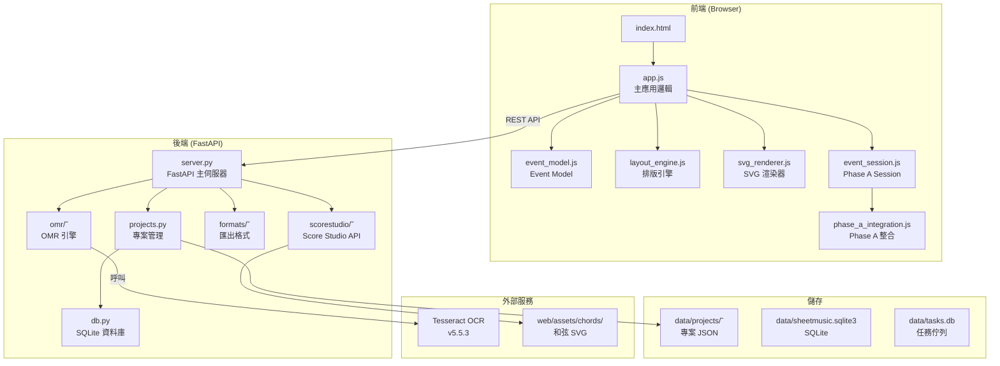

# 系統架構與資料流

## 一、系統架構圖



## 二、資料流

### 2.1 專案載入流程

```
使用者開啟頁面
    ↓
GET /api/projects (列出所有專案)
    ↓
使用者選擇專案
    ↓
GET /api/projects/{id} (載入 project.json)
    ↓
app.js 解析 JSON
    ↓
renderSola321Score() 渲染 Legacy view
    ↓
(Phase A) EventModel.legacyToEvents() 轉換
    ↓
LayoutEngine.layoutMeasure() 計算座標
    ↓
SvgRenderer.renderMeasure() 產生 SVG
```

### 2.2 編輯流程 (Legacy)

```
使用者點擊音符
    ↓
bindSola321Inputs → openSolaNoteOverlay()
    ↓
顯示 overlay input
    ↓
使用者輸入新值
    ↓
onBlur / Enter → 寫入 m.noteText
    ↓
renderSola321Score(false) 重繪
    ↓
solaPushUndo() 記錄快照
```

### 2.3 儲存流程

```
使用者點擊「保存」
    ↓
solaPushUndo() (若有未儲存的變更)
    ↓
PUT /api/projects/{id}
    ↓
projects.py 寫入 project.json
    ↓
atomic backup 到 versions/
    ↓
回應 success
```

### 2.4 Event Model 轉換流程

```
Legacy doc (project.json)
    ↓
ensureEventModel(m) [L2038]
    ↓
parseMeasureToEvents(m) [L2054]
    ↓
legacyToEvents(doc) [event_model.js]
    ↓
Event Model (melodyEvents/lyricTracks/chordEvents)
    ↓
(Phase A) LayoutEngine.layoutMeasure()
    ↓
Layout Result (x/width 座標)
    ↓
SvgRenderer.renderMeasure()
    ↓
SVG DOM
```

## 三、核心模組關係

### 3.1 app.js (主應用)

**主要職責**:
1. 專案載入/儲存
2. Legacy renderer (renderSola321Score)
3. Event Model 轉換 (ensureEventModel)
4. 編輯互動 (bindSola321Inputs)
5. Undo/Redo (solaPushUndo/solaUndo)
6. UI 狀態管理 (state3)

**關鍵函數**:
- `renderSola321Score(rebuild)` — 主渲染器
- `renderSola321Measure(m, mi, ...)` — 單一小節渲染
- `renderV3ChordSlots(m, mi)` — 和弦渲染
- `bindSola321Inputs()` — 綁定編輯事件
- `openSolaNoteOverlay(el)` — 音符編輯 overlay
- `openSolaLyricOverlay(sylEl)` — 歌詞編輯 overlay
- `solaPushUndo()` — 推入 undo stack
- `solaUndo()` / `solaRedo()` — 復原/重做
- `ensureEventModel(m)` — 確保 Event Model 存在
- `parseMeasureToEvents(m)` — Legacy → Event 轉換

**版本**: OMR-SOLA-7

### 3.2 event_model.js (Event Model)

**主要職責**: Legacy → Event 轉換

**主要函數**:
- `legacyToEvents(doc)` — 轉換整個文件
- `noteEvent(spec)` — 建立音符事件
- `lyricEvent(spec)` — 建立歌詞事件
- `chordEvent(spec)` — 建立和弦事件
- `measure(spec)` — 建立小節容器

**Event 結構**:
```javascript
{
  id: 'ev-note-001',
  type: 'note',
  start: 0,        // tick 位置
  duration: 1,     // 時值（拍數）
  pitch: '1',      // 音高 (0-7)
  octave: null,    // 八度偏移
  accidental: null, // 升降記號
  dotted: false,   // 附點
  tieStart: false, // 連音起始
  tieEnd: false,   // 連音結束
  rest: false      // 休止符
}
```

### 3.3 layout_engine.js (排版引擎)

**主要職責**: tick → X 座標轉換

**主要函數**:
- `timeToX(start, options)` — tick → X
- `durationToWidth(duration, options)` — 時值 → 寬度
- `layoutEvent(event, options)` — 單個事件排版
- `layoutMeasure(measure, options)` — 整個小節排版

**選項**:
```javascript
{
  beatsPerMeasure: 4,  // 小節拍數
  beatWidth: 48,       // 每拍寬度 (px)
  leftPadding: 8       // 左邊距 (px)
}
```

**輸出**:
```javascript
{
  measure: 0,
  measureWidth: 192,  // 4 * 48
  melody: [{ eventId, start, duration, x, width }, ...],
  lyrics: [...],
  chords: [...]
}
```

### 3.4 svg_renderer.js (SVG 渲染器)

**主要職責**: Layout Result → SVG 字串

**主要函數**:
- `renderMeasure(layoutResult, events, options)` — 渲染整個小節

**輸出**: SVG 字串，包含:
- chord track (上方)
- melody track (中間)
- lyric track (下方)
- barlines (小節線)
- insert points (插入點，淡色)

### 3.5 phase_a_integration.js (Phase A 整合)

**主要職責**: 整合 Event Session 到頁面

**主要函數**:
- `init()` — 初始化
- `showPreview()` — 顯示預覽
- `hidePreview()` — 隱藏預覽
- `bindToggles()` — 綁定按鈕

**全域物件**:
- `PhaseA` — Phase A API
- `EventSession` — Event Session 實例

## 四、資料模型

### 4.1 Legacy 格式 (project.json)

```json
{
  "id": "doc_5be87fa46594",
  "title": "Last Dance",
  "key": "G",
  "timeSignature": "4/4",
  "tempo": 80,
  "measures": [
    {
      "number": 1,
      "noteText": "3 2 3 2 2 1 1 6",
      "chordText": "B G D/F",
      "lyricText": "所以暫時將你眼睛",
      "lyricText2": "",
      "lyricText3": "",
      "lyricText4": "",
      "chordOffsets": [],
      "barline": true,
      "marks": ""
    }
  ]
}
```

### 4.2 Event Model 格式 (in-memory)

```javascript
{
  measure: 1,
  melodyEvents: [
    { id: 'm0.note.0', type: 'note', start: 0, duration: 1, pitch: '3', ... }
  ],
  lyricTracks: [
    [{ id: 'm0.lyric.0', type: 'lyric', start: 0, duration: 1, text: '所' }],
    [], [], []
  ],
  chordEvents: [
    { id: 'm0.chord.0', type: 'chord', start: 0, duration: null, text: 'B' }
  ],
  annotations: []
}
```

## 五、API 端點

### 5.1 專案管理

| Method | Path | 說明 |
|--------|------|------|
| GET | /api/projects | 列出所有專案 |
| GET | /api/projects/{id} | 取得專案 |
| PUT | /api/projects/{id} | 儲存專案 |
| DELETE | /api/projects/{id} | 刪除專案 |
| POST | /api/projects | 建立新專案 |

### 5.2 OMR

| Method | Path | 說明 |
|--------|------|------|
| POST | /api/omr/process | 處理上傳檔案 |
| GET | /api/omr/status | 查詢處理狀態 |

### 5.3 匯出

| Method | Path | 說明 |
|--------|------|------|
| POST | /api/export/musicxml | 匯出 MusicXML |
| POST | /api/export/midi | 匯出 MIDI |
| POST | /api/export/word | 匯出 Word |
| POST | /api/export/sola321 | 匯出 Sola321 |
| POST | /api/export/pdf | 匯出 PDF |

### 5.4 Score Studio

| Method | Path | 說明 |
|--------|------|------|
| GET | /api/scorestudio/projects | 列出 Score Studio 專案 |
| GET | /api/scorestudio/projects/{id} | 取得專案 |
| PUT | /api/scorestudio/projects/{id} | 儲存專案 |

## 六、重要限制

### 6.1 Legacy 格式限制

1. **無 tick 座標**: 位置由 token index 隱式決定
2. **無 duration**: 所有音符預設 duration=1
3. **無事件 ID**: 無法追蹤個別事件
4. **歌詞是字串**: 無法精確控制每個音節位置

### 6.2 Event Model 限制

1. **不持久化**: 重新載入後重建
2. **ID 不穩定**: nextId() 全局 seq，重新載入會變化
3. **無寫回**: Event → Legacy 轉換可能遺失資訊

### 6.3 編輯能力限制

1. **無法任意插入**: 只能追加或修改既有 token
2. **無法移動**: 無拖曳功能
3. **和弦圖未恢復**: renderV3ChordSlots 只輸出文字
4. **Insert Points 靜態**: 僅可視化，不可點擊

